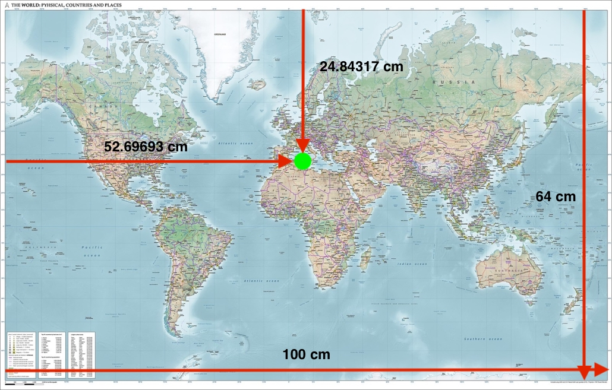
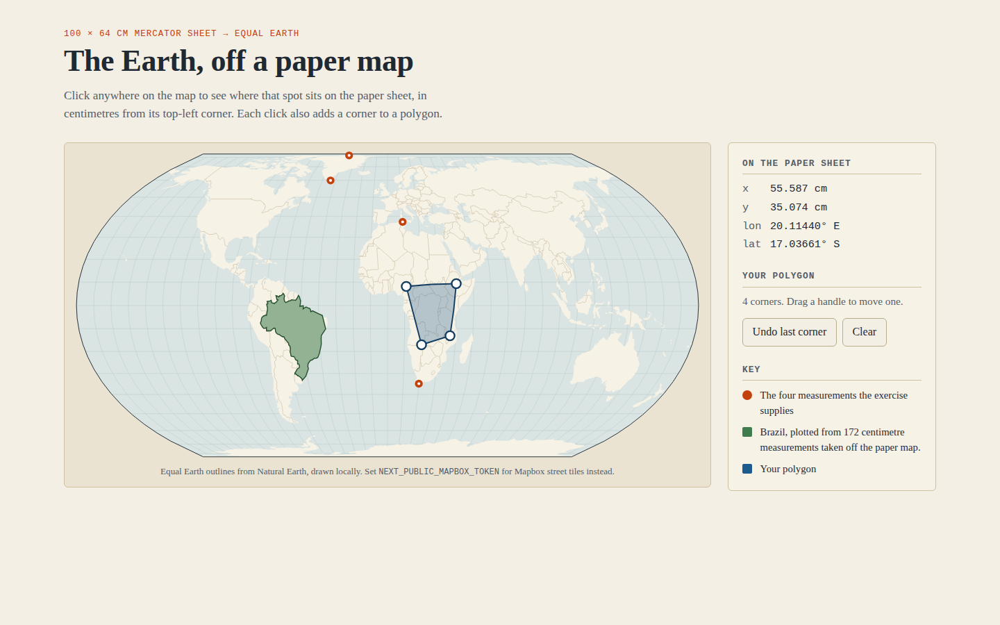
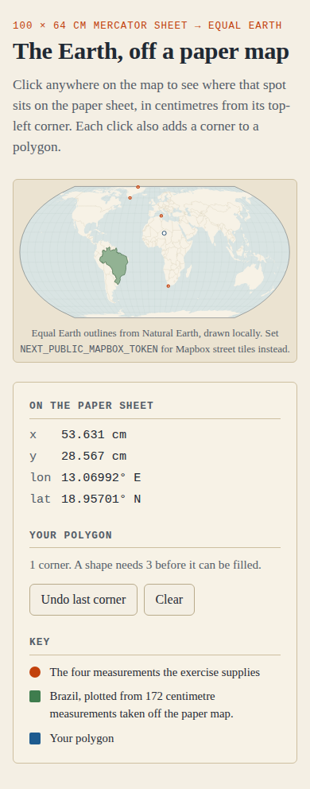
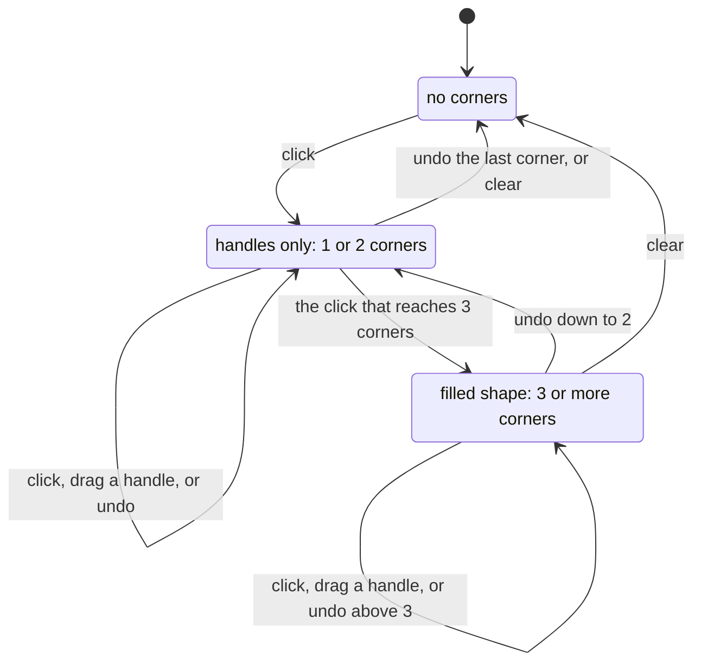

# The Earth, off a paper map

Take a ruler to a 100 × 64 cm Mercator wall map and read off "52.69693 cm across,
24.84317 cm down". This app tells you that is 9.70895°E, 37.30287°N, the top
of Africa. It plots the answer on an **Equal Earth** map, where Greenland stops
being bigger than Africa. It also works the other way: click anywhere and it
tells you where that spot sits on the paper sheet.

It began as a take-home exercise (hence the package name,
`biodock-react-maps-interview`) and stays at that scope.

## What it looks like

The supplied paper map, with the `TopOfAfrica` measurement marked on it:



The same world in Equal Earth. Brazil's green outline does **not** come from a
geographic dataset. It is 172 centimetre measurements taken off the paper map
(`public/partial-brazil.json`), each one pushed through the conversion. It
lands on the Natural Earth outline of Brazil underneath, which is the clearest
evidence that the maths is right. The vermilion pins are the four measurements
the exercise supplies. The blue shape is a polygon built from four clicks, and
the panel shows the last click's reading in centimetres and degrees.



On a phone the panel stacks under the map:



## The conversion

Two functions in `src/domain/conversion.ts`. Nothing else in the project matters
as much:

| | |
|---|---|
| longitude | a linear rescale of `x` from `[0, 100] cm` onto `[-180, 180]°` |
| latitude | the **Gudermannian** of `y` rescaled onto `[π, -π]`: `atan(sinh y)` |
| inverse | `atanh(sin φ)`, which is where Mercator's vertical stretch comes from |

The module imports nothing: no React, no Next.js, no map library. It is plain
arithmetic over `{ x, y }` and `{ lng, lat }` objects, so the whole suite runs
offline in about a second.

Two properties are worth calling out. Both are pinned by name in
`src/domain/conversion.test.ts`:

- **The map edge is 85.0511°, not 90°.** Mercator sends latitude 90° to infinite
  height, so a sheet of finite size has to stop short. `y = 0` yields
  +85.0511287798066°. *"has no jump at the top and bottom edges"* checks that
  the function stays continuous there instead of snapping the top row of paper
  onto the North Pole.
- **The poles clamp instead of diverging.** `inverseGudermannian(±90)` really
  does go to infinity, so the reverse conversion returns the map edge:
  *"clamps to the map edge instead of returning Infinity"*.

The exercise's own point is a test too: *"draws Greenland taller than Africa on
paper"* and *"but Africa spans about three times the latitude"*. The second
asserts that the ratio is between 2.9 and 3.1.

## What a click does

Every click converts the clicked longitude and latitude back to paper
centimetres for the panel, and adds a corner to your polygon. The polygon has
three states. The middle one is the non-obvious part: one or two corners draw
handles but no shape, because a GeoJSON linear ring needs three distinct
vertices to enclose an area (`MINIMUM_RING_VERTICES` in `src/domain/polygon.ts`).



Every change goes through `editPolygon` (`src/domain/polygonEditing.ts`), a
reducer with its own tests. Both basemaps render from that one state, so the
page behaves the same with or without a Mapbox token.

## Running it

Node 22 (see `.nvmrc`):

```bash
npm ci
npm run dev            # http://localhost:4500
```

That needs no configuration and no network. Without a Mapbox token the map is
drawn locally in SVG from Natural Earth outlines, as in the screenshots above.
Clicking, readings and polygon editing all work the same.

For Mapbox street tiles underneath instead, add your own free
[Mapbox public token](https://account.mapbox.com/access-tokens/). This
repository ships none:

```bash
cp .env.example .env.local     # then put your pk.… token in it
npm run dev
```

Or run the production build in Docker, which serves the same app on port 4500
and reports healthy once `/api/health` answers:

```bash
cp .env.example .env           # optional: the token, read at build time
docker compose up --build      # http://localhost:4500
```

## Environment

| Variable | Required | Default | Purpose |
|---|---|---|---|
| `NEXT_PUBLIC_MAPBOX_TOKEN` | No | unset | **Your own** Mapbox public token. Unset means the local Natural Earth map. |
| `PORT` | No | `4500` | Port that `npm run dev` and `npm start` listen on. |
| `HOST_PORT` | No | `4500` | Host port that `docker compose` publishes to. |
| `NEXT_TELEMETRY_DISABLED` | No | `1` | Set by the npm scripts and the Dockerfile. |

`NEXT_PUBLIC_*` values are substituted into the JavaScript bundle when the app is
**built**, not when it starts. Setting the token on an already-built container
does nothing, which is why `docker-compose.yml` passes it as a build argument
rather than an environment variable.

A Mapbox *public* token is meant to be visible in client-side code, so shipping
one in a bundle is not a leak in itself. It is billed to whoever owns it,
though, so use your own and restrict it by URL in the Mapbox dashboard.

## Scripts

```bash
npm run dev          # dev server on $PORT (default 4500)
npm run build        # production build; fails on type errors
npm start            # serve the production build
npm test             # vitest: 51 tests across 7 files
npm run lint         # eslint with Next's core-web-vitals rules
npm run typecheck    # tsc --noEmit
```

`npm test` is offline by design. `test/setup.ts` replaces `fetch` and
`XMLHttpRequest` with stubs that throw. A test that tried to reach Mapbox for
tiles, which costs real money per request on someone's account, fails loudly
instead of passing on one machine and failing on another.

## API

Four read-only routes, used by the page and by the container healthcheck:

```console
$ curl -s localhost:4500/api/health
{"status":"ok"}

$ curl -s localhost:4500/api/brazil | head -c 80
[
  [35.66398620605469, 31.241943359375004],
  [35.46257019042969, 31.4531249999

$ curl -s -D - -o /dev/null localhost:4500/api/countries/coords
HTTP/1.1 200 OK
Content-Type: application/json; charset=utf-8
Content-Length: 634452
Cache-Control: public, max-age=86400, immutable
```

`/api/countries/physical` serves the same outlines as paper centimetres.

## Where things live

```
src/
  domain/          pure logic. No React, no Mapbox, no fs.
    conversion.ts        the two conversions and the Mercator limit
    pointsOfInterest.ts  the four supplied measurements and their published answers
    polygon.ts           coordinates -> a closed GeoJSON ring
    polygonEditing.ts    append / move / undo / clear, as a reducer
    outlineProjection.ts the Equal Earth projection for the local map (d3-geo)
  server/          node-only. Reads files, writes responses.
    datasets.ts          the registry of every file the API serves
    serveDataset.ts      resolve, stream, cache, 404
  hooks/useCoastline.ts  fetch centimetre measurements, convert, expose
  components/
    EarthMap.tsx         the Mapbox map, used when a token is set
    OutlineMap.tsx       the SVG map from Natural Earth, used when it is not
    LngLatPolygon.tsx    a Mapbox polygon with optional draggable handles
    ReadingPanel.tsx     the reading, the polygon controls and the key
  pages/index.tsx  page state and the choice of basemap
  pages/api/       three dataset routes and /api/health
public/            partial-brazil.json, the merged country files, the paper map images
world-geojson/     the script that builds public/countries_*.json (see its README)
scripts/           thin_coastline.py: keep one coastline vertex in every N
```

Each `domain/` and `server/` module has its own `*.test.ts` next to it.

## Decisions worth explaining

**The map works without a token.** Mapbox GL JS v3 needs a valid token before
it draws anything, even a basemap Mapbox does not host, so the token-free path
does not use it. `OutlineMap` projects Natural Earth's 1:110m outlines
(the `world-atlas` package) with d3-geo's `geoEqualEarth` into plain SVG, so it
needs no token, no WebGL and no network. Two details needed care, and both have
tests:
d3 draws on the sphere, where a counter-clockwise ring means "the whole world
except this shape", so `toSphericalPolygon` rewinds any ring that would cover
more than a hemisphere. And Equal Earth's inverse happily returns coordinates
for clicks in the empty corners, so `invertOnGlobe` round-trips each click and
drops the ones that are not on the globe.

**Each basemap loads after paint, and only if used.** Both maps are pulled in
with `next/dynamic` and `ssr: false`, so each becomes a chunk the browser
fetches separately. Without a token, Mapbox GL JS is never downloaded. With one,
the ~100 KB of outlines are never downloaded.

**The country files are cached hard.** `countries_coords.json` and
`countries_physical.json` are about 1.2 MB together and never change for a
given deploy, so `serveDataset` sends `public, max-age=86400, immutable`. The
test *"declares JSON, the exact length, and a cache policy"* pins it.

**One registry instead of a copy of the streaming code per route.** Every
dataset is declared once in `server/datasets.ts`. One tested helper resolves it
from `process.cwd()` and streams it. Resolving from the working directory rather
than `__dirname` matters, because a `__dirname`-relative path encodes where the
compiler put the route, and that changes under `output: "standalone"`.
*"resolves paths against the given root, not the compiler's output layout"*
is the test for it.

**The Python generator is checked against the TypeScript conversion.**
`world-geojson/get_all_polygons.py` has its own copy of the conversion.
`countryOutlines.test.ts` recomputes every one of the ~14,000 paper
measurements it wrote with `conversion.ts` and requires agreement to 1e-9 cm.

## Data and licences

The code is MIT-licensed (`LICENSE`). The data has its own terms:

| Data | Source | Terms |
|---|---|---|
| Natural Earth outlines for the local map | [`world-atlas`](https://github.com/topojson/world-atlas) 2.0.2, from [Natural Earth](https://www.naturalearthdata.com/) 1:110m | Public domain (package: ISC) |
| `public/countries_coords.json`, `public/countries_physical.json` | Derived from [georgique/world-geojson](https://github.com/georgique/world-geojson) | GPL-3.0-or-later, **not** MIT. See `world-geojson/README.md` |
| `public/partial-brazil.json`, `public/map.jpg`, `public/map-measurement.jpg` | Supplied with the original exercise | Provenance not stated by the exercise |
| Mapbox street tiles (optional) | Mapbox, with your own token | Mapbox terms of service |

The 24 MB of per-country source outlines that the merged files are built from
are not in the repository. `world-geojson/README.md` explains how to fetch them
and regenerate.

## Known gaps

- **No component or end-to-end tests in the repository.** The conversion, the
  projection helpers, the polygon reducer, the datasets and the API helper are
  covered by 51 unit tests. The React components are checked by `tsc` and by
  driving the built page in a headless browser by hand.
- **Drawing is pointer-only.** The panel and its buttons work from the
  keyboard, but adding or dragging a corner needs a mouse or a finger.
- **The sheet is hardcoded at 100 × 64 cm.** The exercise specifies one map, so
  the dimensions are constants rather than configuration.
- **The country files are served but not drawn.** `/api/countries/*` serve the
  merged outlines whole; nothing in the UI consumes them, and a client that did
  would want them filtered or tiled rather than as one ~600 KB response.
- **The polygon is not persisted.** Reloading the page loses it.
